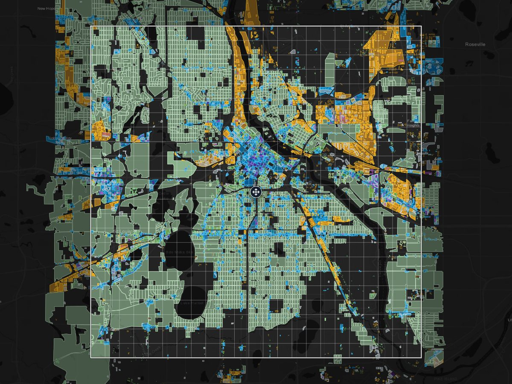

# CS2 OSM Toolkit

**Mirá qué zona de Cities: Skylines 2 va en cada manzana de una ciudad real y exportá el área jugable como PNG para el mod Image Overlay.** Hecho con datos de OpenStreetMap. Gratis, en el navegador, sin instalar nada.

[](https://osyanne.github.io/CitiesSkylines2-osm-toolkit/visualizer/)

**[Abrir el mapa](https://osyanne.github.io/CitiesSkylines2-osm-toolkit/visualizer/)** · **[Pedir tu ciudad](https://github.com/Osyanne/CitiesSkylines2-osm-toolkit/issues/new?template=city-request.yml)** · **[Usarlo en CS2](#usar-el-mapa-en-cs2-image-overlay)**


> 🇬🇧 English version: [README.md](README.md)

---

## Usar el mapa en CS2 (Image Overlay)

1. Instalá el mod [Image Overlay](https://github.com/algernon-A/ImageOverlay).
2. En el mapa de la ciudad, apretá **Export for CS2** (o prendé **Playable area**), mové el cuadrado sobre la parte de la ciudad que querés y apretá **Export PNG**. 4096 px son unos 3,5 m por píxel. Elegí **Transparent** si preferís ver el terreno debajo de las zonas.
3. Poné el PNG en `%USERPROFILE%\AppData\LocalLow\Colossal Order\Cities Skylines II\Overlays` y elegilo en la configuración del mod.

El mod estira la imagen sobre el área jugable de 14.336 m (14,3 km) y la centra, así que coincide sin escalar nada. Construí con el norte arriba. El tamaño de la imagen cambia cuánto detalle muestra: una imagen más grande dibuja el mapa más de cerca, con más etiquetas y detalles chicos.

El mapa es una referencia para construir: no pone las zonas en el juego por vos.

---

## Ciudades

**77 ciudades** en 31 países, listas para explorar en el navegador sin instalar nada:

**https://osyanne.github.io/CitiesSkylines2-osm-toolkit/**

<details>
<summary>Lista completa</summary>

| Ciudad | País | Capas |
|--------|------|-------|
| Amersfoort | Países Bajos | Zonificación |
| Amsterdam | Países Bajos | Zonificación |
| Antwerp | Bélgica | Zonificación |
| Atlanta, GA | EE. UU. | Zonificación |
| Bacău | Rumania | Zonificación |
| Beverlo | Bélgica | Zonificación |
| Białystok | Polonia | Zonificación |
| Bremen | Alemania | Zonificación |
| Buenos Aires | Argentina | Zonificación |
| Butterworth, Penang | Malasia | Zonificación |
| Cagayan de Oro | Filipinas | Zonificación |
| Cardiff | Reino Unido | Zonificación |
| Carmel, IN | EE. UU. | Zonificación |
| Charleston, SC | EE. UU. | Zonificación |
| Chicago, IL | EE. UU. | Zonificación, calles, servicios |
| Chișinău | Moldavia | Zonificación |
| Cincinnati, OH | EE. UU. | Zonificación |
| Clermont-Ferrand | Francia | Zonificación |
| Denizli | Turquía | Zonificación |
| Denton, TX | EE. UU. | Zonificación |
| Detroit, MI | EE. UU. | Zonificación |
| Drammen | Noruega | Zonificación |
| Edinburgh | Reino Unido | Zonificación |
| Elche | España | Zonificación |
| Fayetteville, NC | EE. UU. | Zonificación |
| Galway | Irlanda | Zonificación |
| Ghent | Bélgica | Zonificación |
| Gotemburgo | Suecia | Zonificación |
| Groninga | Países Bajos | Zonificación |
| Hamburg | Alemania | Zonificación |
| Hollister, CA | EE. UU. | Zonificación |
| Hong Kong | Hong Kong | Zonificación |
| Houston, TX | EE. UU. | Zonificación |
| Kansas City, MO | EE. UU. | Zonificación |
| Kiel | Alemania | Zonificación |
| Køge | Dinamarca | Zonificación |
| Kursk | Rusia | Zonificación |
| Kyiv | Ucrania | Zonificación |
| La Plata | Argentina | Zonificación, huellas de edificios de Google |
| Leipzig | Alemania | Zonificación |
| Little Rock, AR | EE. UU. | Zonificación |
| Ljubljana | Eslovenia | Zonificación |
| Łódź | Polonia | Zonificación |
| Lübeck | Alemania | Zonificación |
| Lyon | Francia | Zonificación |
| Madison, WI | EE. UU. | Zonificación |
| Mafra, SC | Brasil | Zonificación, huellas de edificios de Google |
| Málaga | España | Zonificación |
| Marseille | Francia | Zonificación |
| Milan | Italia | Zonificación |
| Minneapolis, MN | EE. UU. | Zonificación, calles, servicios, transporte, zonificación oficial, infraestructura |
| Munich | Alemania | Zonificación |
| New York, NY | EE. UU. | Zonificación |
| Philadelphia, PA | EE. UU. | Zonificación |
| Pittsburgh, PA | EE. UU. | Zonificación |
| Pune | India | Zonificación |
| Recife | Brasil | Zonificación |
| Reims | Francia | Zonificación |
| Reston, VA | EE. UU. | Zonificación |
| Roscommon | Irlanda | Zonificación |
| Róterdam | Países Bajos | Zonificación |
| Sacramento, CA | EE. UU. | Zonificación |
| Scranton, PA | EE. UU. | Zonificación |
| Seattle, WA | EE. UU. | Zonificación |
| Sídney | Australia | Zonificación |
| Singapur | Singapur | Zonificación |
| Sioux Falls, SD | EE. UU. | Zonificación |
| St. Louis, MO | EE. UU. | Zonificación |
| Timișoara | Rumania | Zonificación |
| Toronto, ON | Canadá | Zonificación |
| Trondheim | Noruega | Zonificación |
| Tulsa, OK | EE. UU. | Zonificación |
| Valparaíso | Chile | Zonificación, huellas de edificios de Google |
| Vancouver, BC | Canadá | Zonificación |
| Wrocław | Polonia | Zonificación |
| Yogyakarta | Indonesia | Zonificación |
| Zürich | Suiza | Zonificación |

</details>

Todas las ciudades tienen zonificación. Minneapolis y Chicago además tienen calles y servicios, y Minneapolis suma transporte, zonificación oficial e infraestructura.

### Agregá tu ciudad

La forma más fácil: abrí el mapa de cualquier ciudad, buscá la tuya, prendé el área jugable, movela adonde quieras y apretá **Request this area**. Se abre un [City Request issue](https://github.com/Osyanne/CitiesSkylines2-osm-toolkit/issues/new?template=city-request.yml) con la caja ya completa; sumale el nombre y mandalo. Las ciudades nuevas salen en lotes semanales y te avisamos en el mismo issue cuando la tuya esté lista.

---

## Inicio rápido — Elige tu camino

### Opción A: Solo ver los mapas

Dos opciones:

**Opción 1 — Hosteado (sin setup, sin instalar nada):** Visitá https://osyanne.github.io/CitiesSkylines2-osm-toolkit/ en tu browser. Hacé clic en cualquier tarjeta de ciudad para abrir el mapa.

**Opción 2 — Clonar localmente (necesitás un mini HTTP server):** Cloná el repo, después serví el folder `visualizer/` por HTTP:

```bash
git clone https://github.com/Osyanne/CitiesSkylines2-osm-toolkit.git
cd CitiesSkylines2-osm-toolkit/visualizer
python -m http.server 8000
```

Abrí `http://localhost:8000/` (la landing) o `http://localhost:8000/map.html?city=<slug>` (el mapa de una ciudad) en tu browser. Los datos de todas las ciudades están incluidos en el repo, así que no hace falta descargar nada extra.

> **¿Por qué HTTP y no doble clic?** El visualizer usa `fetch()` para leer el registro de ciudades y el manifest de cada ciudad. Los browsers bloquean `fetch()` desde URLs `file://` por defecto (política CORS), entonces abrir `index.html` con doble clic muestra el landing pero los mapas de cada ciudad fallan. Cualquier mini HTTP server funciona — el built-in de Python (arriba), `http-server` de Node, o la extensión Live Server de VS Code.

### Opción B: Usarlo para tu ciudad (15–20 minutos, requiere Python)

Guía paso a paso completa: [docs/QUICKSTART.md](docs/QUICKSTART.md).

La versión corta:
1. Instalá Python 3.11+ con la casilla "Add to PATH" marcada, luego instalá uv
2. Abrí una terminal en la carpeta `src/` y ejecutá `uv sync`
3. Agregá tu ciudad en `cities.json` en la raíz del repo, con el bbox y su región de Geofabrik en `pbf_region` (todos los campos están en [Adaptarlo a otras ciudades](#adaptarlo-a-otras-ciudades)), y ejecutá:

        uv run extract-zoning --city your_slug
        uv run extract-vial --city your_slug      (opcional)
        uv run extract-services --city your_slug  (opcional)

   `extract-vial` y `extract-services` leen un solo extracto: si el `pbf_region` de tu ciudad es una lista, salteá esos dos pasos.

4. Ejecutá `uv run generate-landing` para actualizar la landing y `visualizer/cities.json`, la lista de la que el mapa abre las ciudades

5. (Opcional) Generá el thumbnail de la tarjeta de tu ciudad para el landing:

        uv sync --group thumbnails               # one-time install (~300 MB Chromium)
        uv run --group thumbnails playwright install chromium   # one-time
        uv run --group thumbnails generate-thumbnails           # auto-detecta missing

   `generate-thumbnails` lee `cities.json`, navega al map URL deployado de cada ciudad, oculta el chrome UI, y guarda un PNG 1200×800 en `visualizer/assets/thumbnails/<slug>.png`. Flags: `--city <slug>` para uno específico, `--force` para regenerar todos, `--base-url http://localhost:8000` para usar tu servidor local (lo necesita una ciudad que todavía no está en el sitio).

Cada ciudad necesita su entrada en `cities.json`: los extractores leen de ahí su caja y su región de Geofabrik, y el mapa solo abre las ciudades que están en esa lista.

**¿Algo no funciona?** Ver [docs/TROUBLESHOOTING.md](docs/TROUBLESHOOTING.md).

### Opción C: Desarrollar o contribuir

Cloná el repo, ejecutá `uv sync` dentro de `src/` y corré los tests desde ahí con `uv run pytest ../tests/ -m "not network"`. Todos los detalles técnicos abajo.

---

## Fuente de datos: PBF u Overpass

Desde la **v3.4.0**, los extractores de zonificación, calles y servicios leen por
defecto archivos `.osm.pbf` locales bajados de [Geofabrik](https://download.geofabrik.de/),
en vez de la API de Overpass. También `extract-google-buildings`, para el uso del
suelo de OSM con el que clasifica las huellas. Transporte e infraestructura
(`extract-transporte`, `extract-infraestructura`) siguen leyendo solo de Overpass,
y la zonificación oficial sale del portal de datos abiertos de cada ciudad.

**Por qué:** extraer de un PBF es más rápido por ciudad, no tiene límites de uso,
es reproducible (mismo PBF + mismo bbox = misma salida) y no consume recursos
compartidos de la comunidad. La comunidad de OSM desaconseja usar Overpass para
extracciones masivas; los PBF de Geofabrik son el camino recomendado.

**Cómo funciona:**

1. Cada ciudad de `cities.json` declara su región de Geofabrik:

   ```json
   "minneapolis": {
       ...campos existentes...,
       "pbf_region": "north-america/us/minnesota"
   }
   ```

   Una ciudad cuya caja cruza el borde de un extracto lista todas las regiones
   que necesita, y `extract-zoning` lee cada una:

   ```json
   "pbf_region": ["europe/netherlands/utrecht", "europe/netherlands/gelderland"]
   ```

   `extract-vial`, `extract-services` y `extract-google-buildings` todavía leen
   una sola región, así que con esas ciudades no andan.

2. La primera extracción de una ciudad baja el PBF de su región a
   `~/.cache/cs2-osm-toolkit/pbf/` (queda en caché 7 días y después se renueva).

3. Las extracciones siguientes de cualquier ciudad de la misma región reusan la caché.

**Espacio:** un PBF regional suele pesar unos cientos de MB (el de Minnesota,
unos 262 MB), y un estado grande o un país entero puede pasar 1 GB (California,
Países Bajos, Polonia). Tenelo en cuenta.

**Renovar la caché a mano:**

```bash
uv run extract-zoning --city minneapolis --refresh-pbf
```

**Modo Overpass** (no recomendado para extracciones masivas): zonificación,
calles, servicios y edificios de Google siguen aceptando `--source overpass`.

```bash
uv run extract-zoning --city minneapolis --source overpass
```

Quitar este modo está planeado para la v4.0.0, pero transporte e
infraestructura todavía leen solo de Overpass.

**Rendimiento (medido, v3.4.0):** extracción en una sola pasada con
`query_batch` (agregado durante el desarrollo de la v3.4). La zonificación de
Minneapolis (`extract-zoning --city minneapolis --source pbf`) sobre el PBF de
Minnesota de 262 MB ya en caché: **~19 minutos** para 10 categorías de origen y
204k polígonos clasificados. Overpass suele tardar 5-15 min, pero es más variable
(reintentos, límites, timeouts) y usa infraestructura compartida de la comunidad
de OSM. La primera vez suma ~30-60 s por la descarga del PBF.

---

## ¿Qué hace este toolkit?

Un toolkit modular que extrae datos reales de OpenStreetMap y los renderiza en un mapa dark-mode interactivo (MapLibre GL, dibujado con la GPU desde teselas vectoriales). Zonificación, calles y servicios salen de extractos PBF de Geofabrik, y transporte e infraestructura de la API de Overpass (ver [Fuente de datos](#fuente-de-datos-pbf-u-overpass)). Sirve como referencia visual para construir ciudades reales 1:1 en Cities: Skylines 2. Todas las ciudades tienen zonificación, y Minneapolis tiene seis módulos con unos 300k features. Entre las 77 ciudades suman unos 7,25M features.

### 🗺 Módulo Zonificación
Clasifica todos los polígonos de edificios en los **11 tipos de zona oficiales de Cities: Skylines 2** (Low/Medium/High Density Housing, Medium Density Row Housing, Mixed Housing, Low Rent Housing, Low/High Density Business, Low/High Density Offices, Industrial Manufacturing). 190.093 polígonos en el bbox de Minneapolis.

Muchos edificios residenciales de OSM no dicen qué tipo de vivienda son. Si el edificio trae `building:levels` o `height`, la altura decide la densidad, pero uno chico de hasta tres pisos que comparte paredes con sus vecinos pasa a casas en hilera. Si no, el extractor mira su forma: los que comparten paredes en una manzana muy construida pasan a densidad media (o a uso mixto si tienen un comercio adentro), los adosados chicos a casas en hilera, y las casas sueltas siguen en baja densidad. Al hacer clic en un edificio, el mapa dice de cuál de estos salió su zona.

Esto lo tienen las ciudades extraídas desde la v3.4.14: todas las que se sumaron desde la v3.5.0, más Amberes, Beverlo, Kiel, Minneapolis, Filadelfia y Nueva York, que se volvieron a extraer. Las demás lo toman la próxima vez que se extraigan. La regla de casas en hilera para los edificios con altura medida llegó en la v3.6.1, y por ahora solo la tienen Filadelfia, Nueva York, Amersfoort y Reston. Las huellas de edificios de Google de Mafra, Valparaíso y La Plata no pasan por nada de esto: se clasifican por uso del suelo, servicios cercanos o tamaño.

Ejecutar: `cd src && uv run extract-zoning --city minneapolis`
Salida: `visualizer/cities/minneapolis/datos_zonificacion.json` (~12 MB, formato compacto)

### 🛣 Módulo Red Vial
Clasifica todas las vías OSM en las **6 categorías de carretera de CS2** (Highway, Major Road, Minor Road, Local Street, Pedestrian Path, Bike Lane). Se renderiza como capa de LineStrings. 108.859 features.

Ejecutar: `cd src && uv run extract-vial --city minneapolis`
Salida: `visualizer/cities/minneapolis/datos_vial.json` (~6 MB, formato compacto)

### 🏥 Módulo Servicios
5 capas alineadas a las solapas de servicios base de Cities: Skylines 2 con buena cobertura OpenStreetMap. En el mapa cada una tiene su marcador, una letra o un árbol:

- **H** Atención sanitaria y funeraria (Healthcare & Deathcare) — hospitales, clínicas, doctors, funeral directors, crematorios, cementerios
- **E** Educación e investigación (Education & Research) — schools, universities, colleges, kindergartens, research institutes
- **F** Bomberos (Fire & Rescue) — fire stations
- **P** Policía y administración (Police & Administration) — police HQ, city hall, courthouses, prison + landmarks culturales (bibliotecas, museos, teatros, arts centres, cinemas) + oficinas de gobierno
- **Árbol** Parques (Parks & Recreation) — parks, nature reserves, gardens, playgrounds, sports centres

Ejecutar: `cd src && uv run extract-services --city minneapolis`
Salida: `visualizer/cities/minneapolis/datos_servicios.js` (~1,2 MB)

**Notas:**
- Bibliotecas, museos, teatros, arts centres, cinemas comparten el bucket `admin` con policía y oficinas de gobierno. Se diferencian solo por nombre + subtype en la ficha Selected.
- Lugares de culto descartados conscientemente (no en estructura CS2 base).
- Electricidad, agua y saneamiento, y basura son un módulo aparte, también de OSM: ver [Capa de infraestructura](#capa-de-infraestructura-minneapolis).
- El bbox de Minneapolis devuelve unos 2.300 features. Los marcadores de puntos aparecen desde el zoom 11.

---

## Features del visualizer

- **Columna de capas** (izquierda; bandeja abajo en el celular): leyenda, filtros y mapa base en un solo lugar
- **On / Dim / Off por capa**: Dim deja calles o servicios atenuados debajo de las zonas
- **Checkbox por categoría + `Only`**: aislar una zona o tipo de vía en un click, `Restore` para volver
- **Señalar y hacer clic**: al pasar el mouse sobre un edificio se ve su zona; con un clic queda fijado en la ficha Selected, que dice de dónde salió la zona y lista las calles, servicios, líneas de transporte e infraestructura del mismo lugar
- **La vista vive en la URL**: posición, capas, zonas ocultas, fuente y mapa base sobreviven a una recarga; `Share` comparte esa vista exacta
- **Área jugable**: un cuadrado de 14.336 m (14,3 km) con la grilla de 23 × 23 tiles del juego, que también prende el botón `Export for CS2`. Se arrastra (o se usa `Center here`) para ver qué parte de la ciudad entra en un mapa de CS2; su posición también va en el link
- **Export PNG**: guarda lo que hay dentro del área jugable como una imagen cuadrada (2048 o 4096 px, y 8192 si la placa de video lo permite), con el mapa o con fondo transparente, lista para el mod Image Overlay
- **Medir en celdas de 8 m**: la escala muestra metros y celdas de zonificación de CS2 (`200 m · 25 cells`), y `Measure` permite marcar puntos y ver cada tramo y el total en metros y celdas, para saber qué profundidad tiene una manzana o cuánto mide una calle
- **Tamaño de la zona**: la ficha de una zona seleccionada muestra su área y a cuántas celdas de 8 × 8 m equivale (`≈ 1,200 m² · ≈ 19 cells`). Es una equivalencia, no un conteo: cuántas celdas se pueden zonificar depende de las calles que la rodean
- **Buscador**: encuentra una calle o un lugar y lleva el mapa ahí, con un pin y la calle resaltada; los lugares de la ciudad aparecen primero. Usa [Nominatim](https://nominatim.org/), el buscador de OpenStreetMap, según su [política de uso](https://operations.osmfoundation.org/policies/nominatim/): busca al apretar Enter (nunca mientras escribís), como mucho una vez por segundo, y las búsquedas repetidas salen de una caché local. El servicio se configura en `visualizer/search-config.json`, así que se puede cambiar o apagar sin tocar código
- **Teselas vectoriales**: MapLibre GL dibuja zonificación y calles con la GPU, y el navegador baja solo las teselas que están en pantalla
- **Detalle según el zoom**: las casas y los estacionamientos de menos de 3.000 m² aparecen desde el zoom 13, las calles locales desde el 11, las ciclovías desde el 12 y las sendas peatonales desde el 13; las manzanas y los edificios grandes se ven siempre
- **Paleta fiel a CS2**: 4 familias (verde/azul/morado/amarillo) alineadas al HUD del juego
- **Tema oscuro**: basemap Esri Dark Gray, oscurecido hacia el casi negro del juego, o las imágenes satelitales de Esri con `Satellite`
- **Persistencia**: capas, fuente de zonas y mapa base guardados en localStorage (`cs2-view-state-{slug}-v2`, con scope por ciudad); la vista de un link le gana a lo guardado

## Zonificación oficial (experimental)

Para ciudades con datos de planificación públicos, el visualizador suma el plan
de la propia ciudad, sacado de su portal de datos abiertos. Un selector arriba
de la capa Zoning elige `OSM-derived`, `Official plan` o `Compare`.

**Compare** muestra los dos a la vez: las zonas derivadas de OSM como relleno y
los distritos del plan como contornos del color de su zona. Al pasar el mouse o
tocar un edificio se ven su zona y la del plan, o "same zone" cuando coinciden.
El plan dice lo que la ciudad quiere, no lo que hay construido hoy, así que es
normal que haya diferencias.

| Ciudad | Fuente | Estado |
|---|---|---|
| Minneapolis | Plan 2040 de Minneapolis, uso del suelo principal (el uso planeado de cada parcela, no el código de zonificación del Chapter 530) | Publicada: 15 códigos de uso del suelo llevados a 7 zonas de CS2 y al estacionamiento en superficie |
| New York | Distritos de zonificación del NYC Department of City Planning (ZoLA) | Fuente y mapeo en el pipeline (90 códigos de distrito), todavía sin publicar |

### Generando datos oficiales

El pipeline está implementado y testeado, pero los `DATA_URL` de
`src/official_zoning/sources/<city>.py` necesitan ser verificados contra el
portal real antes de que la extracción funcione (los CDNs bloquean
descubrimiento automatizado). Hoy no baja ninguno: el de Minneapolis apunta a
un id de relleno y el de Nueva York devuelve 404.

Quick start:

1. Abrir el portal de la ciudad en el browser:
   - Mpls: https://opendata.minneapolismn.gov/datasets/planning-primary-zoning
   - NYC: https://www1.nyc.gov/site/planning/data-maps/open-data/dwn-gis-zoning.page
2. Click en download shapefile; capturar el URL resuelto desde DevTools Network tab.
3. Actualizar `DATA_URL` en `src/official_zoning/sources/<city>.py`. Bump `last_validated` en el YAML.
4. Correr extracción:
   ```bash
   cd src
   uv run extract-official-zoning --city minneapolis
   ```
5. El manifest se actualiza automáticamente. Re-correr `uv run generate-landing` para refrescar landing.

Agregar una ciudad nueva = un source module en `src/official_zoning/sources/<slug>.py`, registrado en `SOURCES` en `src/official_zoning/sources/__init__.py` + un YAML mapping en `src/official_zoning/mappings/<slug>.yaml` + entrada `official_source` en `cities.json`. Ver Minneapolis como pattern de referencia.

## Capa de tránsito (Minneapolis)

El visualizer dibuja la red Metro Transit de Mpls como capa de 4 categorías, con
las relaciones de rutas de OSM que trae la API de Overpass:

| Categoría | Fuente OSM | Rutas Mpls |
|---|---|---|
| LRT | `route=light_rail` (y `route=tram`) | METRO Blue Line, Green Line, Como-Harriet Streetcar Line |
| Commuter Rail | `route=train` | Amtrak Empire Builder |
| BRT | `route=bus` + nombres de las líneas METRO | líneas METRO A, B, C, D y E, y la Orange Line |
| Bus | `route=bus` (resto) | unas 200 rutas de Metro Transit y otros operadores |

Generar los datos de transporte de una ciudad (Mpls anda de entrada; en otras
ciudades depende de cuánto transporte tenga cargado OSM):

```bash
cd src
uv run extract-transporte --city minneapolis
```

El visualizer toma el módulo nuevo del manifest y suma una fila Transit a la
columna de capas.

**Actualización (2026-05-31):** el clasificador de BRT buscaba `network=METRO` o
el nombre `METRO X Line`, pero en los datos reales de OSM todas las rutas tienen
`network=Metro Transit` y las líneas se llaman `Metro Transit A Line` u `Orange`.
Se arregló detectando el BRT por la forma del nombre y la ref (`" Line"` y los
nombres de colores): METRO A-E y Orange ya se clasifican como BRT.

## Capa de infraestructura (Minneapolis)

El visualizer de Mpls dibuja la infraestructura de servicios real como capa de
4 categorías, sacada de OSM con la API de Overpass (`power=*`, `man_made=*`,
`landuse=landfill`, `amenity=recycling`), igual que la sección de servicios
públicos de Cities: Skylines 2:

| Categoría (etiqueta) | Fuente OSM | Geometría |
|---|---|---|
| `power` / Electricity | `power=plant` (generación) · `power=substation`/`transformer` (subestaciones) · `power=line`/`minor_line` (transmisión) | puntos · polígonos · **líneas** |
| `water` / Water & Sewage | `man_made=water_tower`/`water_works`/`pumping_station`/`water_well`/`reservoir_covered` · `wastewater_plant` | puntos · polígonos |
| `waste` / Garbage | `landuse=landfill` · `amenity=waste_transfer_station` · `man_made=incinerator` · `amenity=recycling` (`recycling_type=centre`) | puntos · polígonos |
| `telecom` / Communications | `man_made=communications_tower` · `mast`/`tower` con `tower:type=communication` · `telecom=data_center` | puntos |

Generar los datos de infraestructura de una ciudad (Mpls anda de entrada):

```bash
cd src
uv run extract-infraestructura --city minneapolis
```

El visualizer toma el módulo nuevo del manifest y suma una fila Utilities a la
columna de capas. Quedan afuera por ser ruido: torres y postes del tendido
eléctrico (`power=tower`/`pole`), paneles solares sueltos de techo (`power=generator`),
contenedores de reciclaje en la calle (`recycling_type=container`) y cables
subterráneos.

---

## Setup técnico

### Requisitos
- Python 3.11+
- [uv](https://docs.astral.sh/uv/) (reemplazo más rápido de pip+venv)

### Setup

```bash
git clone https://github.com/Osyanne/CitiesSkylines2-osm-toolkit.git
cd CitiesSkylines2-osm-toolkit/src
uv sync
```

### Prebuilts (ya están en el repo)

Los archivos prebuilt `datos_*` de todas las ciudades están **commiteados en `visualizer/cities/<slug>/`**. No hace falta descargar nada.

Zonificación, red vial y edificios de Google usan un formato JSON compacto y sin pérdida (`datos_*.json`, alrededor de un cuarto del tamaño de los `.js` viejos — ver [METHODOLOGY.md §9](METHODOLOGY.md)). Si tenés ciudades generadas con una versión anterior, convertilas una vez con `cd src && uv run convert-legacy-data` (o `--city <slug>`).

El mapa no descarga esos archivos enteros: dibuja zonificación y red vial desde **teselas vectoriales** en `visualizer/cities/<slug>/tiles/`, así el navegador baja solo lo que está en pantalla, simplificado para el zoom actual. `extract-zoning`, `extract-vial` y `extract-google-buildings` regeneran las teselas solos; para regenerarlas a mano: `cd src && uv run build-tiles` (o `--city <slug>`). Las ciudades sin teselas igual abren: el visor usa los archivos de datos completos. Ver [METHODOLOGY.md §8](METHODOLOGY.md).

**Para regenerar datos frescos** (ej., tras actualizaciones de OSM):

```bash
cd src
uv run extract-zoning --city minneapolis    # ~3-5 min
uv run extract-vial --city minneapolis      # ~30s
uv run extract-services --city minneapolis  # ~1 min
```

Reemplazá `minneapolis` con cualquier slug del registro `cities.json` (`chicago`, `amsterdam`, `madison`, `lodz`). Cada extracción actualiza el manifest preservando los otros módulos. `extract-vial` y `extract-services` necesitan una ciudad con un solo `pbf_region`; `extract-zoning` también lee las que tienen varios, como `new_york`.

### Levantar el visualizer

```bash
cd visualizer
python -m http.server 8000
# Abrir http://localhost:8000/ (landing) o http://localhost:8000/map.html?city=minneapolis (mapa directo)
```

### Correr tests

```bash
cd src
uv run pytest ../tests/ -m "not network"
```

Así corren los mismos 600+ tests que en CI, de todos los módulos. `uv run pytest` a secas dentro de `src/` no encuentra ningún test: están en `tests/`, en la raíz del repo, junto a `pytest.ini`. Los tests marcados `network` quedan afuera: bajan datos de zonificación oficial o abren el mapa en Chromium (esos también están marcados `browser` y necesitan el grupo `thumbnails`).

---

## Estructura del proyecto

```
cities.json                   # Registro de ciudades (bbox, center, zoom, pbf_region, metadata)
pytest.ini                    # Marcas de los tests (network, browser, integration)
start-visualizer.bat          # Windows: sirve visualizer/ en el puerto 8080 y lo abre

src/
├── pyproject.toml            # Dependencias y los comandos de `uv run` ([project.scripts])
├── shared/
│   ├── registry.py           # Lee cities.json y el manifest.json de cada ciudad
│   ├── pbf_cache.py          # Baja y guarda en caché los PBF de Geofabrik
│   ├── pbf_client.py         # Lee un PBF en una sola pasada (pyosmium)
│   ├── pbf_filters.py        # Filtros de tags para el lector de PBF
│   ├── overpass_client.py    # Cliente Overpass con retry + rotación de endpoints
│   ├── compact.py            # Formato compacto datos_*.json (convert-legacy-data)
│   ├── tiles.py              # Teselas vectoriales por ciudad (build-tiles)
│   ├── landing.py            # generate-landing: index.html, visualizer/cities.json, sitemap.xml
│   ├── thumbnails.py         # generate-thumbnails (Playwright)
│   ├── batch.py              # process-cities: un lote de pedidos de ciudades con un comando
│   └── output_helpers.py     # Helpers compartidos para la salida de los extractores
├── zoning/
│   ├── zones.py              # Modelo de zonas CS2 + filtros PBF y queries Overpass
│   ├── classifiers.py        # Tags de OSM → zona CS2
│   ├── morphology.py         # Densidad residencial por la forma: paredes compartidas, entorno construido
│   ├── morphology_config.py  # Umbrales de las reglas de altura y de forma
│   ├── extract.py            # extract-zoning
│   ├── extract_google_buildings.py  # extract-google-buildings (Google Open Buildings)
│   └── patch_colors.py       # Utility de paleta
├── vial/                     # extract-vial: tag highway de OSM → 6 categorías viales de CS2
├── services/                 # extract-services: tags de OSM → 5 capas de servicios
├── transporte/               # extract-transporte: relaciones de rutas → 4 categorías de transporte
├── infraestructura/          # extract-infraestructura: servicios públicos → 4 categorías
└── official_zoning/          # extract-official-zoning
    ├── sources/              # Un módulo de descarga por ciudad (minneapolis, new_york)
    └── mappings/             # Un YAML por ciudad: código del plan → zona CS2

tests/
├── <módulo>/                 # zoning, vial, services, transporte, infraestructura, official_zoning
├── shared/                   # Registro, PBF, formato compacto, teselas, landing, thumbnails, batch
├── visualizer/               # El mapa en Chromium (marcas network + browser)
├── integration/              # Fuentes de morfología; paridad PBF vs Overpass (opcional, CS2_PARITY_TEST=1)
└── fixtures/                 # monaco-latest.osm.pbf para los tests de PBF

visualizer/                   # El sitio: landing, mapa y datos por ciudad (el index.html de la raíz redirige acá)
├── index.html                # Landing, galería de tarjetas de ciudad (generate-landing)
├── map.html                  # Visor de mapa, se carga como map.html?city=<slug>
├── cities.json               # Copia del cities.json raíz (generate-landing)
├── sitemap.xml               # Landing y mapas de cada ciudad (generate-landing)
├── search-config.json        # Servicio del buscador (Nominatim)
├── cities/
│   ├── minneapolis/          # todos los módulos: zonificación, calles, servicios, transporte, zonificación oficial, infraestructura
│   ├── chicago/              # datos_zonificacion.json + datos_vial.json + datos_servicios.js + tiles/ + manifest.json
│   └── <slug>/               # datos_zonificacion.json + tiles/ + manifest.json (una carpeta por ciudad de cities.json;
│                             #   Mafra, Valparaíso y La Plata suman datos_external_buildings.json)
└── assets/
    ├── hero.jpg, og-image.jpg, landing.css, íconos
    └── thumbnails/           # <slug>.png, una por ciudad

docs/
├── QUICKSTART.md             # Guía ELI5 para usuarios no técnicos
├── TROUBLESHOOTING.md        # Errores comunes y soluciones
├── adapting-to-other-cities.md
├── bbox-mcp-server.md
├── cs2-zone-reference.md
├── github-publishing.md
├── plans/                    # Planes de implementación
├── superpowers/plans/        # Más planes de implementación
├── specs/                    # Specs de diseño
├── mockups/                  # Mockups del rediseño de la landing
└── screenshots/

.github/
├── ISSUE_TEMPLATE/
│   └── city-request.yml      # Template de issue para solicitar ciudad
├── workflows/
│   ├── test.yml              # pytest en cada pull request y cada push a main
│   └── release.yml           # Tag y release de cada versión nueva del CHANGELOG
└── FUNDING.yml               # Links del botón Sponsor
```

---

## Stats del proyecto

| | |
|---|---|
| **Módulos** | Zonificación en las 77 ciudades. Calles y servicios en Minneapolis y Chicago. Transporte, zonificación oficial e infraestructura en Minneapolis. Huellas de edificios de Google en Mafra, Valparaíso y La Plata. |
| **Bounding box** | 77 ciudades, ver `cities.json` |
| **Features totales** | ~7,25M entre todas las ciudades (~6,83M de zonificación) |
| **Tests** | 600+, corren en cada pull request y cada push a `main`, ver el badge de arriba |
| **Última extracción** | Depende de la ciudad, ver cada `manifest.json` |

---

## Adaptarlo a otras ciudades

El pipeline es multi-ciudad mediante el registro `cities.json` en la raíz del repo. Para agregar una ciudad:

1. Agregá una entrada en `cities.json` con `display_name`, `country`, `bbox` (`[sur, oeste, norte, este]`), `center` (`[lat, lon]`), `zoom`, `tagline` y `locale`, más `pbf_region`: la región de Geofabrik (`"north-america/us/minnesota"`), o una lista si la caja entra en otro extracto (`["europe/netherlands/utrecht", "europe/netherlands/gelderland"]` en Amersfoort). Sin `pbf_region`, `extract-zoning` corta con "has no 'pbf_region'". `country_code` (dos letras) es opcional: le pone la bandera a la tarjeta de la landing.
2. Ejecutá `uv run extract-zoning --city <your_slug>` (y opcionalmente `extract-vial` / `extract-services`, solo con un `pbf_region`). Baja el PBF a `~/.cache/cs2-osm-toolkit/pbf/` y escribe `visualizer/cities/<slug>/datos_zonificacion.json`, `manifest.json` y `tiles/`.
3. Ejecutá `uv run generate-landing` para actualizar la landing y `visualizer/cities.json`: el mapa solo abre las ciudades que están ahí.
4. Abrí un PR al repo upstream si querés que quede incluida para todos

Para un lote, `uv run --group thumbnails process-cities <slug> <slug> …` toma ciudades que ya están en `cities.json`, revisa sus cajas contra las regiones de Geofabrik, baja los PBF, extrae la zonificación de a tres ciudades, regenera la landing y saca las miniaturas.

Ver [docs/adapting-to-other-cities.md](docs/adapting-to-other-cities.md) para guía específica por ciudad, ejemplos de bbox y calibración de umbrales de densidad.

---

## Créditos

Salvo las primeras, cada ciudad del sitio está porque alguien la pidió.

| Ciudad | La pidió |
|--------|----------|
| Charleston, SC | [@MrWicK95](https://github.com/MrWicK95) |
| Mafra, SC | [@arthuregood](https://github.com/arthuregood) |
| Trondheim | [@SvenErik1968](https://github.com/SvenErik1968) |
| Bacău | [@VasileStelian](https://github.com/VasileStelian) |
| Fayetteville, NC | [@brooklyn85knight-sys](https://github.com/brooklyn85knight-sys) |
| Sacramento, CA | [@jwkueb](https://github.com/jwkueb) |
| Nueva York, NY | [@ooo-89S](https://github.com/ooo-89S) |
| Hollister, CA | [@gileslcaleb-67](https://github.com/gileslcaleb-67) |
| Butterworth, Penang | [@ansehelm](https://github.com/ansehelm) |
| Amberes | [@tomdelamontagne](https://github.com/tomdelamontagne) |
| Łódź | [@Telduu](https://github.com/Telduu) |
| Kiel | [@bamboucha1](https://github.com/bamboucha1) |
| Kursk | [@gandonuebanovic14-spec](https://github.com/gandonuebanovic14-spec) |
| Cincinnati, OH | [@caleb2656](https://github.com/caleb2656) |
| Pittsburgh, PA | [@WARning296](https://github.com/WARning296) |
| Hong Kong | [@Tableisnottable](https://github.com/Tableisnottable) |
| Little Rock, AR | [@rlprice5525](https://github.com/rlprice5525) |
| Beverlo | [@Hobbel1968](https://github.com/Hobbel1968) |
| Chicago, IL | [@Alan-March](https://github.com/Alan-March) |
| Atlanta, GA | [@BluMan142](https://github.com/BluMan142) |
| Yogyakarta | [@Nazvix](https://github.com/Nazvix) |
| Drammen | [@gwicz](https://github.com/gwicz) |
| Køge | [@gwicz](https://github.com/gwicz) |
| Valparaíso | [@lylesnake](https://github.com/lylesnake) |
| Denton, TX | [@zenful6219](https://github.com/zenful6219) |
| Roscommon | [@robralphs](https://github.com/robralphs) |
| Philadelphia, PA | [@wilberforce95-ship-it](https://github.com/wilberforce95-ship-it) |
| La Plata | [@Markhelabj](https://github.com/Markhelabj) |
| Scranton, PA | [@benjaminfortierdurand](https://github.com/benjaminfortierdurand) |
| Lübeck | [@Forger7](https://github.com/Forger7) |
| Pune | [@aarushkha](https://github.com/aarushkha) |
| Recife | [@meloiss](https://github.com/meloiss) |
| Buenos Aires | [@LucaSammartino](https://github.com/LucaSammartino) |
| Carmel, IN | [@b-galley](https://github.com/b-galley) |
| Kansas City, MO | [@JoshSantiagoKC](https://github.com/JoshSantiagoKC) |
| Seattle, WA | [@lightningbolts](https://github.com/lightningbolts) |
| Sioux Falls, SD | [@DekiDeveloper](https://github.com/DekiDeveloper) |
| Lyon | [@lolo-0-5](https://github.com/lolo-0-5) |
| Zürich | [@Beleggrodion](https://github.com/Beleggrodion) |
| Leipzig | [@fabiandrechsler00-hue](https://github.com/fabiandrechsler00-hue) |
| Edimburgo | [@Mrlopezio](https://github.com/Mrlopezio) |
| Vancouver, BC | [@dylanweicker](https://github.com/dylanweicker) |
| Detroit, MI | [@robinsonkwame](https://github.com/robinsonkwame) |
| Kiev | [@SDR259](https://github.com/SDR259) |
| Múnich | [@bpwned](https://github.com/bpwned) |
| Liubliana | [@nakljucnoime](https://github.com/nakljucnoime) |
| Chisináu | [@warpmd](https://github.com/warpmd) |
| Marsella | [@mister351](https://github.com/mister351) |
| Galway | [@FruitJuice](https://github.com/FruitJuice) |
| Houston, TX | [@Riggest](https://github.com/Riggest) |
| Milán | [@WhiteTuskk](https://github.com/WhiteTuskk) |
| Clermont-Ferrand | [@M4rsten](https://github.com/M4rsten) |
| Gante | [@nysjo85-creator](https://github.com/nysjo85-creator) |
| Hamburgo | [@ne0exe](https://github.com/ne0exe) |
| Bremen | [@ne0exe](https://github.com/ne0exe) |
| St. Louis, MO | [@itsbentex](https://github.com/itsbentex) |
| Denizli | [@muhlisgursoy](https://github.com/muhlisgursoy) |
| Cagayan de Oro | [@reddishdakota](https://github.com/reddishdakota) |
| Wrocław | [@sdejnert](https://github.com/sdejnert) |
| Elche | [@apocalexnow](https://github.com/apocalexnow) |
| Málaga | [@juanjharo](https://github.com/juanjharo) |
| Singapur | [@jackfood2004-blip](https://github.com/jackfood2004-blip) |
| Cardiff | [@chrismansell2008-coder](https://github.com/chrismansell2008-coder) |
| Sídney | [@JulianRifkin](https://github.com/JulianRifkin) |
| Groninga | [@LauraKruithof](https://github.com/LauraKruithof) |
| Gotemburgo | [@Stewjon7](https://github.com/Stewjon7) |
| Róterdam | [@tsuba42](https://github.com/tsuba42) |
| Toronto, ON | [@StuMinkus](https://github.com/StuMinkus) |
| Reims | [@ItsKandar](https://github.com/ItsKandar) |
| Białystok | [@callmebobr](https://github.com/callmebobr) |
| Timișoara | [@darko0904-cpu](https://github.com/darko0904-cpu) |
| Tulsa, OK | [@Cubature1](https://github.com/Cubature1) |
| Amersfoort | [@styx06](https://github.com/styx06) |
| Reston, VA | [@dte324](https://github.com/dte324) |

La herramienta y sus datos son gratis. Si te sirve, podés apoyarla en
[Ko-fi](https://ko-fi.com/osyanne) (aporte único),
[GitHub Sponsors](https://github.com/sponsors/Osyanne) o
[Patreon](https://www.patreon.com/c/CS2OSMToolkit) (mensual).

Quienes apoyan el proyecto también van acá. A nadie se lo agrega sin preguntarle
antes: si apoyás y querés aparecer, escribime y decime cómo preferís figurar.

---

## Privacidad

El sitio cuenta las visitas con [GoatCounter](https://www.goatcounter.com), sin
cookies ni datos personales: registra la página, de dónde vino la visita, el
navegador, el tamaño de la pantalla y el país. Una copia del mapa que corras
vos, en localhost o desde un fork, no manda nada.

## Licencia

MIT. Datos OSM via OpenStreetMap contributors bajo ODbL.
