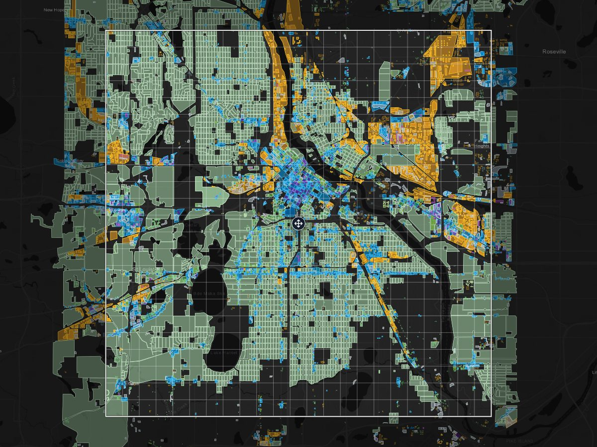

# CS2 OSM Toolkit

**See which Cities: Skylines 2 zone goes on every block of a real city, then export the playable area as a PNG for the Image Overlay mod.** Built from OpenStreetMap. Free, in your browser, nothing to install.

[](https://osyanne.github.io/CitiesSkylines2-osm-toolkit/visualizer/)

**[Open the map](https://osyanne.github.io/CitiesSkylines2-osm-toolkit/visualizer/)** · **[Request your city](https://github.com/Osyanne/CitiesSkylines2-osm-toolkit/issues/new?template=city-request.yml)** · **[Use it in CS2](#using-the-map-in-cs2-image-overlay)**


> 🇪🇸 Versión en español: [README.es.md](README.es.md)

---

## Using the map in CS2 (Image Overlay)

1. Install the [Image Overlay](https://github.com/algernon-A/ImageOverlay) mod.
2. On the city map, press **Export for CS2** (or turn on **Playable area**), move the square over the part of the city you want, and press **Export PNG**. 4096 px is about 3.5 m per pixel. Pick **Transparent** if you'd rather see the terrain under the zones.
3. Put the PNG in `%USERPROFILE%\AppData\LocalLow\Colossal Order\Cities Skylines II\Overlays` and choose it in the mod's settings.

The mod stretches the image over the 14,336 m (14.3 km) playable area and centres it, so it lines up with no extra scaling. Keep north up when you build. The image size changes how much detail it shows: a bigger image renders the map closer in, with more labels and small features.

The map is a reference to build from: it doesn't place zones in the game for you.

---

## Cities

**77 cities** across 31 countries, ready to explore in the browser with nothing to install:

**https://osyanne.github.io/CitiesSkylines2-osm-toolkit/**

<details>
<summary>Full list</summary>

| City | Country | Layers |
|------|---------|--------|
| Amersfoort | Netherlands | Zoning |
| Amsterdam | Netherlands | Zoning |
| Antwerp | Belgium | Zoning |
| Atlanta, GA | USA | Zoning |
| Bacău | Romania | Zoning |
| Beverlo | Belgium | Zoning |
| Białystok | Poland | Zoning |
| Bremen | Germany | Zoning |
| Buenos Aires | Argentina | Zoning |
| Butterworth, Penang | Malaysia | Zoning |
| Cagayan de Oro | Philippines | Zoning |
| Cardiff | United Kingdom | Zoning |
| Carmel, IN | USA | Zoning |
| Charleston, SC | USA | Zoning |
| Chicago, IL | USA | Zoning, roads, services |
| Chișinău | Moldova | Zoning |
| Cincinnati, OH | USA | Zoning |
| Clermont-Ferrand | France | Zoning |
| Denizli | Türkiye | Zoning |
| Denton, TX | USA | Zoning |
| Detroit, MI | USA | Zoning |
| Drammen | Norway | Zoning |
| Edinburgh | United Kingdom | Zoning |
| Elche | Spain | Zoning |
| Fayetteville, NC | USA | Zoning |
| Galway | Ireland | Zoning |
| Ghent | Belgium | Zoning |
| Gothenburg | Sweden | Zoning |
| Groningen | Netherlands | Zoning |
| Hamburg | Germany | Zoning |
| Hollister, CA | USA | Zoning |
| Hong Kong | Hong Kong | Zoning |
| Houston, TX | USA | Zoning |
| Kansas City, MO | USA | Zoning |
| Kiel | Germany | Zoning |
| Køge | Denmark | Zoning |
| Kursk | Russia | Zoning |
| Kyiv | Ukraine | Zoning |
| La Plata | Argentina | Zoning, Google building footprints |
| Leipzig | Germany | Zoning |
| Little Rock, AR | USA | Zoning |
| Ljubljana | Slovenia | Zoning |
| Łódź | Poland | Zoning |
| Lübeck | Germany | Zoning |
| Lyon | France | Zoning |
| Madison, WI | USA | Zoning |
| Mafra, SC | Brazil | Zoning, Google building footprints |
| Málaga | Spain | Zoning |
| Marseille | France | Zoning |
| Milan | Italy | Zoning |
| Minneapolis, MN | USA | Zoning, roads, services, transit, official zoning, infrastructure |
| Munich | Germany | Zoning |
| New York, NY | USA | Zoning |
| Philadelphia, PA | USA | Zoning |
| Pittsburgh, PA | USA | Zoning |
| Pune | India | Zoning |
| Recife | Brazil | Zoning |
| Reims | France | Zoning |
| Reston, VA | USA | Zoning |
| Roscommon | Ireland | Zoning |
| Rotterdam | Netherlands | Zoning |
| Sacramento, CA | USA | Zoning |
| Scranton, PA | USA | Zoning |
| Seattle, WA | USA | Zoning |
| Singapore | Singapore | Zoning |
| Sioux Falls, SD | USA | Zoning |
| St. Louis, MO | USA | Zoning |
| Sydney | Australia | Zoning |
| Timișoara | Romania | Zoning |
| Toronto, ON | Canada | Zoning |
| Trondheim | Norway | Zoning |
| Tulsa, OK | USA | Zoning |
| Valparaíso | Chile | Zoning, Google building footprints |
| Vancouver, BC | Canada | Zoning |
| Wrocław | Poland | Zoning |
| Yogyakarta | Indonesia | Zoning |
| Zürich | Switzerland | Zoning |

</details>

Every city has zoning. Minneapolis and Chicago also have roads and services, and Minneapolis adds transit, official zoning and infrastructure on top.

### Adding your city

The easiest way: open any city's map, search for your city, turn on the playable area, move it where you want and press **Request this area**. A [City Request issue](https://github.com/Osyanne/CitiesSkylines2-osm-toolkit/issues/new?template=city-request.yml) opens with the box already filled in; add the name and send it. New cities go out in weekly batches, and you'll get a reply in the issue once yours is live.

---

## Quick Start — Pick Your Path

### Path A: Just look at the maps

Two options:

**Option 1 — Hosted (zero setup, no install):** Visit https://osyanne.github.io/CitiesSkylines2-osm-toolkit/ in your browser. Click any city card to open the map.

**Option 2 — Local clone (need any tiny HTTP server):** Clone the repo, then serve the `visualizer/` folder over HTTP:

```bash
git clone https://github.com/Osyanne/CitiesSkylines2-osm-toolkit.git
cd CitiesSkylines2-osm-toolkit/visualizer
python -m http.server 8000
```

Open `http://localhost:8000/` (the landing) or `http://localhost:8000/map.html?city=<slug>` (one city's map) in your browser. Every city's data is included in the repo, so there's nothing extra to download.

> **Why HTTP and not just double-click?** The map viewer uses `fetch()` to load the city registry and per-city manifest. Browsers block `fetch()` from `file://` URLs by default (CORS policy), so opening `index.html` directly with double-click shows the landing but city maps fail to load. Any tiny HTTP server works — Python's built-in (above), Node's `http-server`, or VS Code's Live Server extension.

### Path B: Use it for your city (15–20 minutes, requires Python)

Full step-by-step walkthrough: [docs/QUICKSTART.md](docs/QUICKSTART.md).

The short version:
1. Install Python 3.11+ with "Add to PATH" checked, then install uv
2. Open a terminal in the `src/` folder and run `uv sync`
3. Add your city to `cities.json` at repo root, with its bbox and its Geofabrik region in `pbf_region` (all the fields are in [Adapting to Other Cities](#adapting-to-other-cities)), then run:

        uv run extract-zoning --city your_slug
        uv run extract-vial --city your_slug      (optional)
        uv run extract-services --city your_slug  (optional)

   `extract-vial` and `extract-services` read a single extract: skip them if your city's `pbf_region` is a list.

4. Run `uv run generate-landing` to update the landing page and `visualizer/cities.json`, the list the map opens cities from

5. (Optional) Generate a city card thumbnail for the landing page:

        uv sync --group thumbnails               # one-time install (~300 MB Chromium)
        uv run --group thumbnails playwright install chromium   # one-time
        uv run --group thumbnails generate-thumbnails           # auto-detects missing

   `generate-thumbnails` reads `cities.json`, navigates to the deployed map URL per city, hides UI chrome, and saves a 1200×800 PNG to `visualizer/assets/thumbnails/<slug>.png`. Run with `--city <slug>` for a specific one, `--force` to regenerate all, or `--base-url http://localhost:8000` to use your local server (a city that isn't on the site yet needs it).

Every city needs its entry in `cities.json`: the extractors read its box and its Geofabrik region from there, and the map only opens cities listed in it.

**Common issues?** See [docs/TROUBLESHOOTING.md](docs/TROUBLESHOOTING.md).

### Path C: Develop or contribute

Clone the repo, run `uv sync` inside `src/`, then run the tests from there with `uv run pytest ../tests/ -m "not network"`. All technical details below.

---

## Data source: PBF or Overpass

Starting with **v3.4.0**, the zoning, roads and services extractors read from
local `.osm.pbf` files downloaded from [Geofabrik](https://download.geofabrik.de/)
by default, instead of the Overpass API. So does `extract-google-buildings`, for
the OSM land use it classifies the footprints with. Transit and infrastructure
(`extract-transporte`, `extract-infraestructura`) still read only from Overpass,
and official zoning comes from each city's open data portal.

**Why:** PBF extraction is faster per city, has no rate limits, is fully
reproducible (same PBF + same bbox = same output), and doesn't consume shared
community resources. The OSM community explicitly discourages using Overpass
for bulk extraction; Geofabrik PBFs are the recommended path.

**How it works:**

1. Each city in `cities.json` declares its Geofabrik region:

   ```json
   "minneapolis": {
       ...existing fields...,
       "pbf_region": "north-america/us/minnesota"
   }
   ```

   A city whose box crosses the edge of an extract lists every region it
   needs, and `extract-zoning` reads each one:

   ```json
   "pbf_region": ["europe/netherlands/utrecht", "europe/netherlands/gelderland"]
   ```

   `extract-vial`, `extract-services` and `extract-google-buildings` still read
   a single region, so they don't work yet for those cities.

2. The first extraction of a city downloads the regional PBF to
   `~/.cache/cs2-osm-toolkit/pbf/` (cached for 7 days, then refreshed).

3. Subsequent extractions of any city in the same region reuse the cache.

**Storage:** a regional PBF is usually a few hundred MB (Minnesota's is about
262 MB), and a big state or a whole country can pass 1 GB (California, the
Netherlands, Poland). Plan accordingly.

**Refresh cache manually:**

```bash
uv run extract-zoning --city minneapolis --refresh-pbf
```

**Overpass mode** (not recommended for bulk extraction): zoning, roads,
services and Google buildings still accept `--source overpass`.

```bash
uv run extract-zoning --city minneapolis --source overpass
```

Removing this mode is planned for v4.0.0, but transit and infrastructure still
read only from Overpass.

**Performance (measured, v3.4.0):** Single-pass batched extraction via
`query_batch` (introduced mid-v3.4 dev). Minneapolis zoning extraction
(`extract-zoning --city minneapolis --source pbf`) on a cached 262 MB Minnesota
PBF: **~19 minutes** for 10 source categories producing 204k classified
polygons. Compare to Overpass which typically runs 5-15 min but is more
variable (retries, throttling, timeouts) and consumes shared OSM community
infrastructure. First-run adds ~30-60 sec for the PBF download.

---

## What This Does

A modular toolkit that extracts real-world data from OpenStreetMap and renders it on an interactive dark-mode map (MapLibre GL, drawn from vector tiles on the GPU). Zoning, roads and services come from Geofabrik PBF extracts, and transit and infrastructure from the Overpass API (see [Data source](#data-source-pbf-or-overpass)). Built as a reference layer for players recreating real cities 1:1 in Cities: Skylines 2. Every city has zoning, and Minneapolis has six modules with about 300k features. The 77 cities add up to about 7.25M features.

### 🗺 Zoning Module
Classifies all building polygons into the **11 official Cities: Skylines 2 zone types** (Low/Medium/High Density Housing, Medium Density Row Housing, Mixed Housing, Low Rent Housing, Low/High Density Business, Low/High Density Offices, Industrial Manufacturing). 190,093 polygons in the Minneapolis bbox.

Many residential buildings in OSM don't say what kind of housing they are. When a building carries `building:levels` or `height`, its height decides the density, but a small one of up to three floors that shares walls with its neighbours becomes Row Housing. When it doesn't, the extractor looks at its shape: buildings that share walls in a densely built block become Medium Density (or Mixed Housing if a shop sits inside), small attached ones become Row Housing, and detached houses stay Low Density. Click a building on the map to see which of these its zone came from.

Cities extracted since v3.4.14 have this: every city added since v3.5.0, plus Antwerp, Beverlo, Kiel, Minneapolis, Philadelphia and New York, which were extracted again. The others get it when they are next extracted. The Row Housing rule for buildings with a measured height came in v3.6.1, and so far only Philadelphia, New York, Amersfoort and Reston have it. The Google building footprints in Mafra, Valparaíso and La Plata skip all of this: they are classified by land use, nearby amenities or size.

Run: `cd src && uv run extract-zoning --city minneapolis`
Output: `visualizer/cities/minneapolis/datos_zonificacion.json` (~12 MB, compact format)

### 🛣 Road Network Module
Classifies all OSM roads into the **6 CS2 road categories** (Highway, Major Road, Minor Road, Local Street, Pedestrian Path, Bike Lane). Renders as LineString overlay. 108,859 features.

Run: `cd src && uv run extract-vial --city minneapolis`
Output: `visualizer/cities/minneapolis/datos_vial.json` (~6 MB, compact format)

### 🏥 Services Module
5 layers aligned to the base service tabs of Cities: Skylines 2 with good OpenStreetMap coverage. On the map each one has its own marker, a letter or a tree:

- **H** Healthcare & Deathcare — hospitals, clinics, doctors, funeral directors, crematoriums, cemeteries
- **E** Education & Research — schools, universities, colleges, kindergartens, research institutes
- **F** Fire & Rescue — fire stations
- **P** Police & Administration — police HQ, city hall, courthouses, prison + cultural landmarks (libraries, museums, theatres, arts centres, cinemas) + government offices
- **Tree** Parks & Recreation — parks, nature reserves, gardens, playgrounds, sports centres

Run: `cd src && uv run extract-services --city minneapolis`
Output: `visualizer/cities/minneapolis/datos_servicios.js` (~1.2 MB)

**Notes:**
- Libraries, museums, theatres, arts centres, cinemas share the `admin` bucket with police and government offices. They differ only by name + subtype in the Selected card.
- Places of worship intentionally excluded (not in CS2 base game structure).
- Electricity, water & sewage and garbage are their own module, also from OSM: see [Infrastructure overlay](#infrastructure-overlay-minneapolis).
- Minneapolis bbox returns about 2,300 features. Point markers show from zoom 11.

---

## Visualizer Features

- **Layers column** (left; a bottom tray on phones): legend, filters and basemap in one place
- **On / Dim / Off per layer**: Dim keeps roads or services faded under the zones
- **Checkbox per category + `Only`**: isolate one zone or road type in a click, `Restore` to go back
- **Point and click**: pointing at a building shows its zone; clicking pins the Selected card, which says where the zone came from and lists the roads, services, transit lines and utilities at the same spot
- **The view lives in the address**: position, layers, hidden zones, source and basemap survive a reload; `Share` sends that exact view
- **Playable area**: a 14,336 m (14.3 km) square with the game's 23 × 23 tile grid, also turned on by the `Export for CS2` button. Drag it (or use `Center here`) to see which part of the city fits in a CS2 map; its position goes into the link too
- **Export PNG**: saves what's inside the playable area as a square image (2048 or 4096 px, and 8192 when the graphics card allows it), with the map or a transparent background, ready for the Image Overlay mod
- **Measure in 8 m cells**: the scale shows metres and CS2 zoning cells (`200 m · 25 cells`), and `Measure` lets you click points to get each stretch and the total in metres and cells, to check how deep a block is or how long a street runs
- **Zone size**: the details of a selected zone show its area and how many 8 × 8 m cells that is (`≈ 1,200 m² · ≈ 19 cells`). It's an equivalence, not a count: how many cells you can zone depends on the roads around it
- **Search**: find a street or place and jump to it, with a pin and the street highlighted; places inside the city come first. It uses [Nominatim](https://nominatim.org/), OpenStreetMap's search, under its [usage policy](https://operations.osmfoundation.org/policies/nominatim/): it searches when you press Enter (never as you type), at most once a second, and repeated searches come from a local cache. The service is set in `visualizer/search-config.json`, so it can be switched or turned off without touching code
- **Vector tiles**: MapLibre GL draws zoning and roads on the GPU, and the browser only downloads the tiles on screen
- **Detail by zoom**: houses and parking lots under 3,000 m² show from zoom 13, local streets from zoom 11, bike lanes from 12 and footpaths from 13; blocks and bigger buildings stay visible
- **CS2-faithful color palette**: 4 families (green/blue/purple/yellow) aligned to the game HUD
- **Dark theme**: Esri Dark Gray basemap, darkened toward the game's near-black, or Esri satellite imagery with `Satellite`
- **Persistence**: layers, zoning source and basemap saved to localStorage (`cs2-view-state-{slug}-v2`, scoped per city); a link's view wins over what's saved

## Official zoning overlay (experimental)

For cities with public planning data, the visualizer adds the city's own plan,
taken from its open data portal. A switch at the top of the Zoning layer picks
`OSM-derived`, `Official plan` or `Compare`.

**Compare** shows both at once: the OSM-derived zones as the fill and the
plan's districts as outlines in their zone colour. Hover or tap a building to
see its zone and the plan's, or "same zone" when they agree. The plan says what
the city intends, not what is built today, so differences are expected.

| City | Source | Status |
|---|---|---|
| Minneapolis | Minneapolis 2040 Plan, primary land use (the planned use of each parcel, not the Chapter 530 zoning code) | Published: 15 land-use codes mapped to 7 CS2 zones and Surface Parking |
| New York | NYC Department of City Planning zoning districts (ZoLA) | Source and mapping in the pipeline (90 district codes), not published yet |

### Generating official zoning data

The pipeline is implemented and tested, but the upstream `DATA_URL` constants
in `src/official_zoning/sources/<city>.py` need verification against the live
portal before extraction works (portal CDNs block automated discovery). Neither
downloads today: Minneapolis' points at a placeholder id and New York's returns 404.

Quick start:

1. Open the city's open data portal in a browser:
   - Mpls: https://opendata.minneapolismn.gov/datasets/planning-primary-zoning
   - NYC: https://www1.nyc.gov/site/planning/data-maps/open-data/dwn-gis-zoning.page
2. Click the shapefile download link; capture the resolved URL via DevTools Network tab.
3. Update `DATA_URL` in `src/official_zoning/sources/<city>.py`. Bump `last_validated` in `src/official_zoning/mappings/<city>.yaml`.
4. Run extraction:
   ```bash
   cd src
   uv run extract-official-zoning --city minneapolis
   ```
5. Manifest auto-updates with the new module entry. Re-run `uv run generate-landing` to refresh the landing.

Adding a new city = one source module in `src/official_zoning/sources/<slug>.py`, registered in `SOURCES` in `src/official_zoning/sources/__init__.py` + one mapping YAML in `src/official_zoning/mappings/<slug>.yaml` + `official_source` entry in `cities.json`. See Minneapolis as the reference pattern.

## Transit overlay (Minneapolis)

The Mpls visualizer renders the Metro Transit network as a 4-category overlay,
sourced from OSM route relations through the Overpass API:

| Category | Source | Mpls routes |
|---|---|---|
| LRT | OSM `route=light_rail` (and `route=tram`) | METRO Blue Line, Green Line, Como-Harriet Streetcar Line |
| Commuter Rail | OSM `route=train` | Amtrak Empire Builder |
| BRT | OSM `route=bus` + METRO line names | METRO A, B, C, D and E Lines, Orange Line |
| Bus | OSM `route=bus` (rest) | about 200 routes from Metro Transit and other operators |

Generate transit data for a city (Mpls works out of the box; other cities depend on
their OSM transit coverage):

```bash
cd src
uv run extract-transporte --city minneapolis
```

The visualizer picks up the new module from the manifest and adds a Transit row
to the layers column.

**Update (2026-05-31):** The BRT classifier originally keyed on `network=METRO`
/ name `METRO X Line`, but real OSM data tags everything `network=Metro Transit`
and names the lines `Metro Transit A Line` / `Orange`. Fixed by detecting BRT via
name/ref shape (`" Line"` + colour names) — METRO A-E + Orange now classify as BRT.

## Infrastructure overlay (Minneapolis)

The Mpls visualizer renders real utility infrastructure as a 4-category overlay,
sourced from OSM through the Overpass API (`power=*`, `man_made=*`, `landuse=landfill`, `amenity=recycling`),
mirroring the utilities section of Cities: Skylines 2:

| Category (label) | OSM source | Geometry |
|---|---|---|
| `power` / Electricity | `power=plant` (generation) · `power=substation`/`transformer` (substations) · `power=line`/`minor_line` (transmission) | points · polygons · **lines** |
| `water` / Water & Sewage | `man_made=water_tower`/`water_works`/`pumping_station`/`water_well`/`reservoir_covered` · `wastewater_plant` | points · polygons |
| `waste` / Garbage | `landuse=landfill` · `amenity=waste_transfer_station` · `man_made=incinerator` · `amenity=recycling` (`recycling_type=centre`) | points · polygons |
| `telecom` / Communications | `man_made=communications_tower` · `mast`/`tower` with `tower:type=communication` · `telecom=data_center` | points |

Generate infrastructure data for a city (Mpls works out of the box):

```bash
cd src
uv run extract-infraestructura --city minneapolis
```

The visualizer picks up the new module from the manifest and adds a Utilities
row to the layers column. Excluded as clutter: pylons/poles
(`power=tower`/`pole`), individual rooftop solar (`power=generator`), street
recycling bins (`recycling_type=container`), and underground cables.

---

## Technical Setup

### Prerequisites
- Python 3.11+
- [uv](https://docs.astral.sh/uv/) (faster pip+venv replacement)

### Setup

```bash
git clone https://github.com/Osyanne/CitiesSkylines2-osm-toolkit.git
cd CitiesSkylines2-osm-toolkit/src
uv sync
```

### Prebuilts (already in the repo)

The prebuilt `datos_*` files for every city are **committed in `visualizer/cities/<slug>/`**. No download needed.

Zoning, roads and Google buildings use a compact, lossless JSON format (`datos_*.json`, about a quarter of the old `.js` size — see [METHODOLOGY.md §9](METHODOLOGY.md)). If you have cities generated with an older version, convert them once with `cd src && uv run convert-legacy-data` (or `--city <slug>`).

The map does not download those files whole: it draws zoning and roads from **vector tiles** in `visualizer/cities/<slug>/tiles/`, so the browser only fetches what is on screen, simplified for the current zoom. `extract-zoning`, `extract-vial` and `extract-google-buildings` rebuild the tiles on their own; to rebuild them by hand run `cd src && uv run build-tiles` (or `--city <slug>`). Cities without tiles still open — the viewer falls back to the full data files. See [METHODOLOGY.md §8](METHODOLOGY.md).

**To regenerate fresh data** (e.g., after OSM updates):

```bash
cd src
uv run extract-zoning --city minneapolis    # ~3-5 min
uv run extract-vial --city minneapolis      # ~30s
uv run extract-services --city minneapolis  # ~1 min
```

Replace `minneapolis` with any slug from `cities.json` (`chicago`, `amsterdam`, `madison`, `lodz`). Each extract updates the manifest preserving other modules. `extract-vial` and `extract-services` need a city with a single `pbf_region`; `extract-zoning` also reads the ones that list several, like `new_york`.

### Serve the visualizer

```bash
cd visualizer
python -m http.server 8000
# Open http://localhost:8000/ (landing) or http://localhost:8000/map.html?city=minneapolis (direct map)
```

### Run tests

```bash
cd src
uv run pytest ../tests/ -m "not network"
```

That runs the same 600+ tests as CI, from every module. Plain `uv run pytest` inside `src/` finds no tests: they live in `tests/` at the repo root, next to `pytest.ini`. Tests marked `network` are left out: they download official zoning data or open the map in Chromium (those are also marked `browser` and need the `thumbnails` group).

---

## Project Structure

```
cities.json                   # City registry (bbox, center, zoom, pbf_region, metadata)
pytest.ini                    # Test markers (network, browser, integration)
start-visualizer.bat          # Windows: serves visualizer/ on port 8080 and opens it

src/
├── pyproject.toml            # Dependencies and the `uv run` commands ([project.scripts])
├── shared/
│   ├── registry.py           # Reads cities.json and each city's manifest.json
│   ├── pbf_cache.py          # Downloads and caches Geofabrik PBFs
│   ├── pbf_client.py         # Reads a PBF in one pass (pyosmium)
│   ├── pbf_filters.py        # Tag filters for the PBF reader
│   ├── overpass_client.py    # Overpass API client with retry + endpoint rotation
│   ├── compact.py            # Compact datos_*.json format (convert-legacy-data)
│   ├── tiles.py              # Vector tiles per city (build-tiles)
│   ├── landing.py            # generate-landing: index.html, visualizer/cities.json, sitemap.xml
│   ├── thumbnails.py         # generate-thumbnails (Playwright)
│   ├── batch.py              # process-cities: a batch of city requests in one command
│   └── output_helpers.py     # Shared helpers for the extract output
├── zoning/
│   ├── zones.py              # CS2 zone model + PBF filters and Overpass queries
│   ├── classifiers.py        # OSM tags → CS2 zone
│   ├── morphology.py         # Housing density from shape: shared walls, built-up surroundings
│   ├── morphology_config.py  # Thresholds for the height and shape rules
│   ├── extract.py            # extract-zoning
│   ├── extract_google_buildings.py  # extract-google-buildings (Google Open Buildings)
│   └── patch_colors.py       # Color palette utility
├── vial/                     # extract-vial: OSM highway tag → 6 CS2 road categories
├── services/                 # extract-services: OSM tags → 5 service layers
├── transporte/               # extract-transporte: route relations → 4 transit categories
├── infraestructura/          # extract-infraestructura: utilities → 4 categories
└── official_zoning/          # extract-official-zoning
    ├── sources/              # One download module per city (minneapolis, new_york)
    └── mappings/             # One YAML per city: plan code → CS2 zone

tests/
├── <module>/                 # zoning, vial, services, transporte, infraestructura, official_zoning
├── shared/                   # Registry, PBF, compact format, tiles, landing, thumbnails, batch
├── visualizer/               # The map in Chromium (network + browser markers)
├── integration/              # Morphology sources; PBF vs Overpass parity (opt-in, CS2_PARITY_TEST=1)
└── fixtures/                 # monaco-latest.osm.pbf for the PBF tests

visualizer/                   # The site: landing, map and city data (the root index.html redirects here)
├── index.html                # Landing page, gallery of city cards (generate-landing)
├── map.html                  # Map viewer, loaded as map.html?city=<slug>
├── cities.json               # Copy of the root cities.json (generate-landing)
├── sitemap.xml               # Landing and city maps (generate-landing)
├── search-config.json        # Search service (Nominatim)
├── cities/
│   ├── minneapolis/          # every module: zoning, roads, services, transit, official zoning, infrastructure
│   ├── chicago/              # datos_zonificacion.json + datos_vial.json + datos_servicios.js + tiles/ + manifest.json
│   └── <slug>/               # datos_zonificacion.json + tiles/ + manifest.json (one folder per city in cities.json;
│                             #   Mafra, Valparaíso and La Plata add datos_external_buildings.json)
└── assets/
    ├── hero.jpg, og-image.jpg, landing.css, icons
    └── thumbnails/           # <slug>.png, one per city

docs/
├── QUICKSTART.md             # ELI5 guide for non-technical users
├── TROUBLESHOOTING.md        # Common errors and fixes
├── adapting-to-other-cities.md
├── bbox-mcp-server.md
├── cs2-zone-reference.md
├── github-publishing.md
├── plans/                    # Implementation plans
├── superpowers/plans/        # More implementation plans
├── specs/                    # Design specs
├── mockups/                  # Landing redesign mockups
└── screenshots/

.github/
├── ISSUE_TEMPLATE/
│   └── city-request.yml      # City request issue template
├── workflows/
│   ├── test.yml              # pytest on every pull request and push to main
│   └── release.yml           # Tags and publishes each new CHANGELOG version
└── FUNDING.yml               # Sponsor button links
```

---

## Project Stats

| | |
|---|---|
| **Modules** | Zoning in all 77 cities. Roads and services in Minneapolis and Chicago. Transit, official zoning and infrastructure in Minneapolis. Google building footprints in Mafra, Valparaíso and La Plata. |
| **Bounding box** | 77 cities, see `cities.json` |
| **Total features** | ~7.25M across all cities (~6.83M of them zoning) |
| **Tests** | 600+, run on every pull request and push to `main`, see the badge at the top |
| **Last extracted** | Varies per city, see each `manifest.json` |

---

## Adapting to Other Cities

The pipeline is multi-city via `cities.json` registry at the repo root. To add a city:

1. Add an entry to `cities.json` with `display_name`, `country`, `bbox` (`[south, west, north, east]`), `center` (`[lat, lon]`), `zoom`, `tagline` and `locale`, plus `pbf_region`: the Geofabrik region (`"north-america/us/minnesota"`), or a list when the box crosses into another extract (`["europe/netherlands/utrecht", "europe/netherlands/gelderland"]` for Amersfoort). Without `pbf_region`, `extract-zoning` stops with "has no 'pbf_region'". `country_code` (two letters) is optional: it gives the landing card its flag.
2. Run `uv run extract-zoning --city <your_slug>` (and optionally `extract-vial` / `extract-services`, for a single `pbf_region` only). It downloads the PBF to `~/.cache/cs2-osm-toolkit/pbf/` and writes `visualizer/cities/<slug>/datos_zonificacion.json`, `manifest.json` and `tiles/`.
3. Run `uv run generate-landing` to update the landing and `visualizer/cities.json`: the map only opens cities listed there.
4. Open a PR to the upstream repo if you want it included for everyone

For a batch, `uv run --group thumbnails process-cities <slug> <slug> …` takes cities already in `cities.json`, checks their boxes against the Geofabrik regions, downloads the PBFs, extracts their zoning three cities at a time, regenerates the landing and takes the thumbnails.

See [docs/adapting-to-other-cities.md](docs/adapting-to-other-cities.md) for city-specific guidance, example bboxes, and density threshold calibration.

---

## Credits

Every city on the site past the first few is here because someone asked for it.

| City | Requested by |
|------|--------------|
| Charleston, SC | [@MrWicK95](https://github.com/MrWicK95) |
| Mafra, SC | [@arthuregood](https://github.com/arthuregood) |
| Trondheim | [@SvenErik1968](https://github.com/SvenErik1968) |
| Bacău | [@VasileStelian](https://github.com/VasileStelian) |
| Fayetteville, NC | [@brooklyn85knight-sys](https://github.com/brooklyn85knight-sys) |
| Sacramento, CA | [@jwkueb](https://github.com/jwkueb) |
| New York, NY | [@ooo-89S](https://github.com/ooo-89S) |
| Hollister, CA | [@gileslcaleb-67](https://github.com/gileslcaleb-67) |
| Butterworth, Penang | [@ansehelm](https://github.com/ansehelm) |
| Antwerp | [@tomdelamontagne](https://github.com/tomdelamontagne) |
| Łódź | [@Telduu](https://github.com/Telduu) |
| Kiel | [@bamboucha1](https://github.com/bamboucha1) |
| Kursk | [@gandonuebanovic14-spec](https://github.com/gandonuebanovic14-spec) |
| Cincinnati, OH | [@caleb2656](https://github.com/caleb2656) |
| Pittsburgh, PA | [@WARning296](https://github.com/WARning296) |
| Hong Kong | [@Tableisnottable](https://github.com/Tableisnottable) |
| Little Rock, AR | [@rlprice5525](https://github.com/rlprice5525) |
| Beverlo | [@Hobbel1968](https://github.com/Hobbel1968) |
| Chicago, IL | [@Alan-March](https://github.com/Alan-March) |
| Atlanta, GA | [@BluMan142](https://github.com/BluMan142) |
| Yogyakarta | [@Nazvix](https://github.com/Nazvix) |
| Drammen | [@gwicz](https://github.com/gwicz) |
| Køge | [@gwicz](https://github.com/gwicz) |
| Valparaíso | [@lylesnake](https://github.com/lylesnake) |
| Denton, TX | [@zenful6219](https://github.com/zenful6219) |
| Roscommon | [@robralphs](https://github.com/robralphs) |
| Philadelphia, PA | [@wilberforce95-ship-it](https://github.com/wilberforce95-ship-it) |
| La Plata | [@Markhelabj](https://github.com/Markhelabj) |
| Scranton, PA | [@benjaminfortierdurand](https://github.com/benjaminfortierdurand) |
| Lübeck | [@Forger7](https://github.com/Forger7) |
| Pune | [@aarushkha](https://github.com/aarushkha) |
| Recife | [@meloiss](https://github.com/meloiss) |
| Buenos Aires | [@LucaSammartino](https://github.com/LucaSammartino) |
| Carmel, IN | [@b-galley](https://github.com/b-galley) |
| Kansas City, MO | [@JoshSantiagoKC](https://github.com/JoshSantiagoKC) |
| Seattle, WA | [@lightningbolts](https://github.com/lightningbolts) |
| Sioux Falls, SD | [@DekiDeveloper](https://github.com/DekiDeveloper) |
| Lyon | [@lolo-0-5](https://github.com/lolo-0-5) |
| Zürich | [@Beleggrodion](https://github.com/Beleggrodion) |
| Leipzig | [@fabiandrechsler00-hue](https://github.com/fabiandrechsler00-hue) |
| Edinburgh | [@Mrlopezio](https://github.com/Mrlopezio) |
| Vancouver, BC | [@dylanweicker](https://github.com/dylanweicker) |
| Detroit, MI | [@robinsonkwame](https://github.com/robinsonkwame) |
| Kyiv | [@SDR259](https://github.com/SDR259) |
| Munich | [@bpwned](https://github.com/bpwned) |
| Ljubljana | [@nakljucnoime](https://github.com/nakljucnoime) |
| Chișinău | [@warpmd](https://github.com/warpmd) |
| Marseille | [@mister351](https://github.com/mister351) |
| Galway | [@FruitJuice](https://github.com/FruitJuice) |
| Houston, TX | [@Riggest](https://github.com/Riggest) |
| Milan | [@WhiteTuskk](https://github.com/WhiteTuskk) |
| Clermont-Ferrand | [@M4rsten](https://github.com/M4rsten) |
| Ghent | [@nysjo85-creator](https://github.com/nysjo85-creator) |
| Hamburg | [@ne0exe](https://github.com/ne0exe) |
| Bremen | [@ne0exe](https://github.com/ne0exe) |
| St. Louis, MO | [@itsbentex](https://github.com/itsbentex) |
| Denizli | [@muhlisgursoy](https://github.com/muhlisgursoy) |
| Cagayan de Oro | [@reddishdakota](https://github.com/reddishdakota) |
| Wrocław | [@sdejnert](https://github.com/sdejnert) |
| Elche | [@apocalexnow](https://github.com/apocalexnow) |
| Málaga | [@juanjharo](https://github.com/juanjharo) |
| Singapore | [@jackfood2004-blip](https://github.com/jackfood2004-blip) |
| Cardiff | [@chrismansell2008-coder](https://github.com/chrismansell2008-coder) |
| Sydney | [@JulianRifkin](https://github.com/JulianRifkin) |
| Groningen | [@LauraKruithof](https://github.com/LauraKruithof) |
| Gothenburg | [@Stewjon7](https://github.com/Stewjon7) |
| Rotterdam | [@tsuba42](https://github.com/tsuba42) |
| Toronto, ON | [@StuMinkus](https://github.com/StuMinkus) |
| Reims | [@ItsKandar](https://github.com/ItsKandar) |
| Białystok | [@callmebobr](https://github.com/callmebobr) |
| Timișoara | [@darko0904-cpu](https://github.com/darko0904-cpu) |
| Tulsa, OK | [@Cubature1](https://github.com/Cubature1) |
| Amersfoort | [@styx06](https://github.com/styx06) |
| Reston, VA | [@dte324](https://github.com/dte324) |

The toolkit and its data are free. If it's useful to you, you can support it on
[Ko-fi](https://ko-fi.com/osyanne) (one-off tip),
[GitHub Sponsors](https://github.com/sponsors/Osyanne) or
[Patreon](https://www.patreon.com/c/CS2OSMToolkit) (monthly).

Supporters are credited here as well. Nobody is listed without asking first — if
you support the project and want to appear, send a message and say how you'd
like to be named.

---

## Privacy

The website counts visits with [GoatCounter](https://www.goatcounter.com),
without cookies or personal data: it records the page, where the visit came
from, the browser, the screen size and the country. A copy of the map you run
yourself, on localhost or from a fork, sends nothing.

## License

MIT. OSM data via OpenStreetMap contributors under ODbL.
